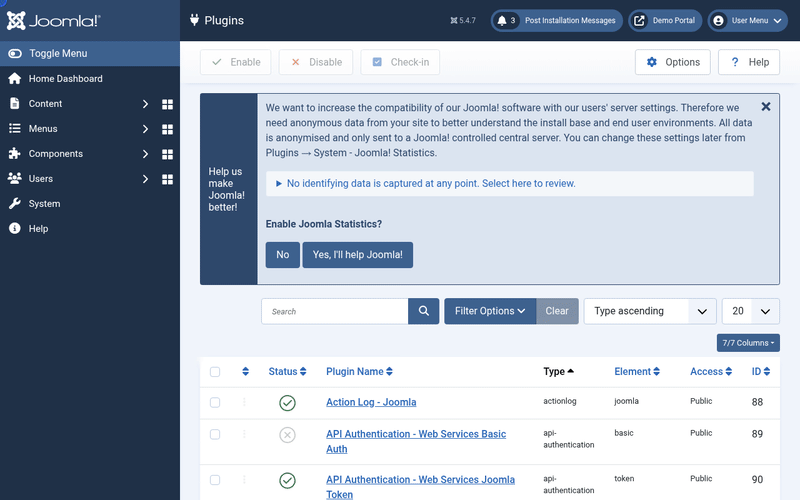

# Conferbot Joomla Plugin

Embeds the [Conferbot](https://conferbot.com) AI chat widget on every frontend page of a Joomla 4/5 site and passes the logged-in user identity plus site context to the bot.

## See it in action

Paste the Chatbot ID, enable the plugin, and the bot is live on the site - 30 seconds end to end:



[HD video (MP4)](docs/demo.mp4) - also attached to the [latest release](https://github.com/Conferbot/conferbot-joomla/releases).

## How it works

The plugin subscribes to `onBeforeCompileHead` and injects the standard Conferbot loader snippet into the document head of every frontend (site client) HTML page:

```html
<script src="https://cdn.conferbot.com/dist/v1/widget.min.js" async id="conferbot-js"></script>
<script>
  window.ConferbotWidget("<CHATBOT_ID>", "live_chat", {
    user:       { id: "joomla-<user_id>", name, email },   // logged-in user, if any
    customData: { platform: "joomla", siteName, siteUrl, siteLanguage }
  });
</script>
```

The only credential needed is the **Chatbot ID** (the bot's ID from the Conferbot dashboard). All widget appearance and behavior - position, colors, theme, language, auto-open, proactive prompts, disabled URLs - is configured in the Conferbot dashboard under **Customize** and delivered to the widget at runtime; the plugin does not duplicate those settings.

`options.user` and `options.customData` become the visitor's identity/context in Conferbot chats, so the bot and human agents see the user's name, email, and site details.

## Requirements

- Joomla 4.2+ or 5.x
- PHP 7.4+
- A Conferbot account with a published chatbot (or use the built-in demo bot to try it first)

## Installation

1. Zip the plugin folder contents as `plg_system_conferbot.zip` (the manifest `conferbot.xml` must be at the top level of the zip).
2. In the Joomla administrator, go to **System > Install > Extensions** and upload the zip.
3. Go to **System > Manage > Plugins**, search for "Conferbot", open **System - Conferbot**.
4. Paste your **Chatbot ID**, set the **Status** to *Enabled*, and click **Save**.

## Configuration

Enable/disable is Joomla's own plugin publish state; everything else lives in the plugin options. You can paste the bare ID, the full embed snippet, or a dashboard URL into the Chatbot ID field - the plugin extracts the ID for you when you save.

**No account yet?** Paste `691c970890527a0468f9b2c9` to try our demo bot - it works right away, no signup needed.

| Setting | Description |
|---|---|
| Chatbot ID | Required. In the Conferbot dashboard open your bot, click **Share**, then **Copy Bot ID** (24-character hex). |
| How the chat appears | Floating chat bubble (default) or popup window. |
| Widget script URL | Leave as is for the Conferbot CDN. Useful for staging/self-hosted widget builds. *(Advanced)* |

## Architecture

The extension class only wires Joomla events and params; all computation lives in a pure, individually tested helper:

```
conferbot-joomla/
├── conferbot.xml                              # Manifest: files, namespace, param fields
├── services/
│   └── provider.php                           # Joomla 4/5 DI service provider
├── src/
│   ├── Extension/
│   │   └── Conferbot.php                      # SubscriberInterface plugin: head injection + save-time ID normalisation
│   └── Helper/
│       └── LoaderHelper.php                   # Pure helper: bot ID parsing/validation, options, safe JSON, snippet render
├── language/en-GB/
│   ├── plg_system_conferbot.ini               # Param UI strings
│   └── plg_system_conferbot.sys.ini           # Name/description for extension lists
├── tests/                                     # PHPUnit suite (not shipped in the zip)
├── phpunit.xml
├── logo.png
└── LICENSE                                    # GPL-2.0-or-later
```

The helper never touches Joomla APIs, so the whole contract (extraction, validation, option building, script-injection safety, rendered snippet) is unit-tested without a Joomla installation.

## Tests

19 PHPUnit tests (58 assertions) cover bot ID extraction (bare ID, embed snippet, dashboard URL, whitespace, uppercase), strict validation, the demo bot ID, embed type normalisation, widget option building (guest/logged-in variants), script-injection safety of the inlined JSON (`</script>` in a user name cannot break out), and the rendered loader snippet.

```bash
# any PHP 7.4+ with phpunit 9:
phpunit

# or containerized:
docker run --rm -v "$PWD":/mod -v /path/to/phpunit-9.phar:/phpunit.phar:ro \
  -w /mod php:8.2-cli php /phpunit.phar
```

## Manual verification

1. Save the plugin with a valid Chatbot ID (or the demo bot) and set it to *Enabled*.
2. Open the site frontend - the chat bubble should appear (subject to the bot's own dashboard settings such as disabled URLs and load delay).
3. Log in as a Joomla user and start a chat: the conversation in the Conferbot inbox should show the user's name/email and site context.

## Notes & limitations

- No API key or workspace ID is required - the widget resolves everything server-side from the Chatbot ID over Socket.IO (`wdt.conferbot.com`).
- The widget is injected on the site client only; administrator pages are never touched.
- If the widget does not appear: check the plugin is enabled (System > Plugins), the Chatbot ID is correct and the bot is published/not disabled, and clear the Joomla cache (**System > Clear Cache**).

## License

GNU General Public License version 2 or later (GPL-2.0-or-later); see [LICENSE](LICENSE).
